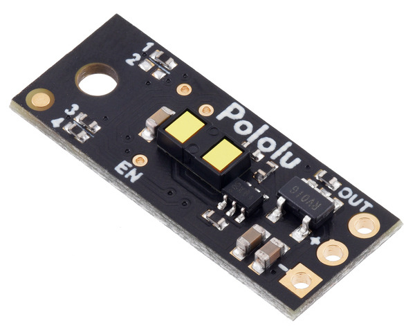
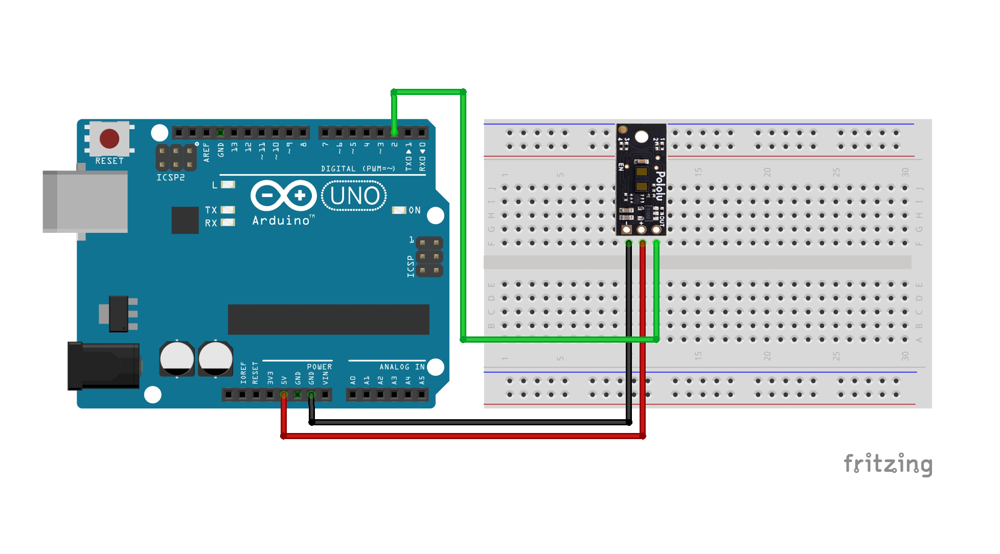
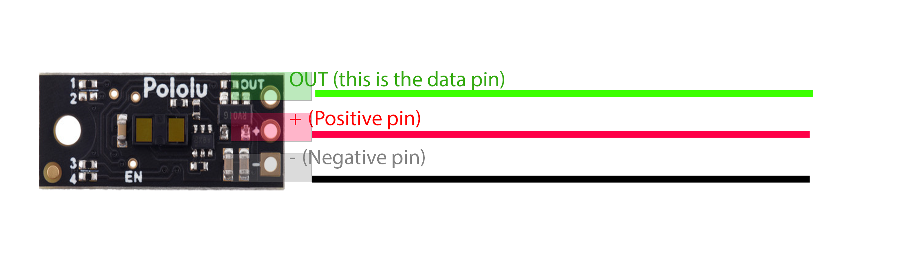
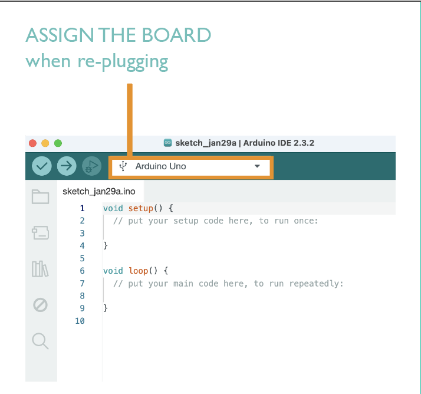
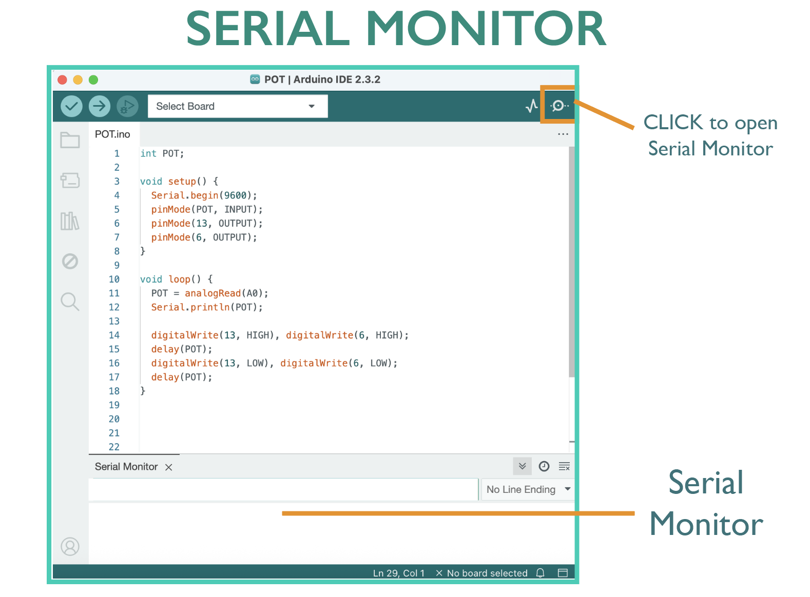

# Pololu IR Distance Sensor - 300cm MAX

### DESCRIPTION 

This small lidar-based distance sensor reports the distance of objects up to about 300cm away with a pulsed (PWM) signal. A digital microcontroller pin can be used to time the length of each high pulse, which encodes the measured distance. 

----
### SPECIFICATIONS

- Operating voltage: 3.0 V to 5.5 V

- Current consumption: 30 mA (typical) when enabled, 0.4 mA when disabled

- Maximum range: approximately 300 cm (120″) (for high-reflectivity targets in good ambient conditions; lower-reflectivity targets or poor ambient conditions will reduce the maximum detection range)

- Minimum range: 4 cm (for accurate measurement); < 1 mm (for detection)

- Resolution: 2 mm

- Update rate: 30 Hz to 33 Hz (33 ms to 30 ms period)

- Field of view (FOV): 15° typical; can vary with object reflectance and ambient conditions
  
----
# TUTORIAL

----
### WIRING

Click on images to expand

----
### CODE and ISNTRUCTIONS

- After you have finished the wiring, plug the Arduino board to your computer

- Open the Arduino IDE (remember to select the correct board at the top left of the Arduino IDE)

  
  
- Copy [this code](https://github.com/kingston-hackSpace/Distance_Sensors/blob/main/pololu_distance_basic.ino) and upload it to your board.

- Open the serial monitor to see your readings

  

- Done!

- With a ruler, check that the incoming values match real distance values. Sensor values may lose accuracy due to environmental factors.

----
### MORE EXAMPLES

1. TURN ON AN LED USING A DISTANCE SENSOR (CREATE A THRESHOLD)

   - [Diagram](https://github.com/kingston-hackSpace/Distance_ultrasonic-pololuIR_sensors/blob/main/PololuDistance_diagram2.jpg)
  
   - [Code](https://github.com/kingston-hackSpace/Distance_ultrasonic-pololuIR_sensors/blob/main/pololu_distance_LED.ino)

2. MAKE A COUNTER USING THE DISTANCE SENSOR

  - [Diagram](https://github.com/kingston-hackSpace/Distance_ultrasonic-pololuIR_sensors/blob/main/PololuDistance_diagram2.jpg)

  - [Code]

  - Bonus: remember counting when re-powered, [code]

4. CONTROL THE BRIGHTNESS OF AN LED USING A DISTANCE SENSOR
----
## FURTHER INFORMATION

Read more about this sensor module [here](https://www.pololu.com/product/4079)
